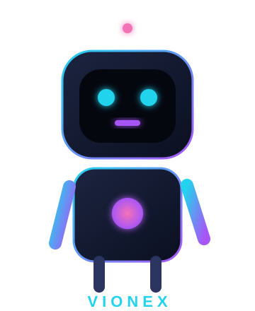
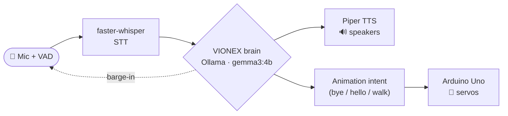

<div align="center">


<a href="https://github.com/ananvaypandey/VIONEX-AI">
  
</a>

<br/>


</div>


## 🤖 What is VIONEX AI?

**VIONEX** is a friendly little humanoid robot companion that you talk to — completely **offline**. It listens through a microphone, understands **Hindi, English and natural Hinglish**, thinks with a local LLM, answers out loud, and moves its arms and head to match the conversation.

No cloud. No API keys. Your voice never leaves your machine.

<div align="center">



<sub>🎙️ <b>...listening...</b></sub>

</div>

## ✨ Features

| 🎙️ Voice in | 🧠 Local brain | 🔊 Voice out | 🦾 Body |
|---|---|---|---|
| faster-whisper STT | Ollama `gemma3:4b` | Piper neural TTS (offline) | Arduino + 16 servos |
| Hindi · English · Hinglish | streaming, keeps model warm | ~0.1 s time-to-voice | talk / bye / hello / walk |

- **🗣️ Interrupt anytime (barge-in)** — start talking while VIONEX is speaking and he stops instantly to listen.
- **🌐 Hindi + English only** — mis-detected foreign languages are re-read as Hindi, so you never get stray scripts.
- **🪪 Knows who he is** — name **VIONEX**, built by **Team VIONEX**, led by **Ananvay Pandey**, under **Viokes Technologies Private Limited**.
- **🔌 Plug-and-play robot** — auto-connects on `COM9` (or auto-detects the Arduino) and reconnects if unplugged.
- **🧪 Mock mode** — `--mock` runs the whole AI with no hardware attached.

## 🧩 How it works



## 📁 Repository layout

```text
ROBOT AI/                 <- git repo root
├── README.md
├── .gitignore
└── V1/                   <- Version 1 (this release)
    ├── main.py           # voice loop + barge-in + robot orchestration
    ├── config.yaml       # models, voices, VAD, serial port, tuning
    ├── requirements.txt
    ├── PROTOCOL.md       # Arduino serial protocol
    ├── ai/               # audio · vad · stt · llm · tts
    ├── robot/            # base · mock · serial_link
    ├── firmware/         # Arduino .ino
    └── voices/           # piper .onnx models (git-ignored, ~60 MB each)
```

> New versions get their own folder (`V2/`, `V3/`, …) so every release stays browsable.

## 🚀 Quick start

```bash
# 1. from the version folder
cd V1

# 2. install python dependencies
pip install -r requirements.txt

# 3. get the local model (once)
ollama pull gemma3:4b
ollama serve

# 4. drop piper voices into voices/  (hi.onnx, ur.onnx, en.onnx  +  .onnx.json)
#    -> https://huggingface.co/rhasspy/piper-voices

# 5. (optional) flash the Arduino firmware
arduino-cli compile --upload -p COM9 firmware/roboto_firmware

# 6. run
python main.py            # real robot on COM9 (auto-connects)
python main.py --mock     # no hardware, just the conversation
```

CLI flags: `--mock` · `--serial` · `--port COM9` · `--config config.yaml` · `--list-devices`

## ⚙️ Configuration (highlights)

```yaml
stt:
  model: "small"            # tiny | base | small | medium | large-v3
  languages: ["hi", "en"]   # ignore stray detections
  fallback_language: "hi"

tts:
  engine: "piper"           # offline, fast
  piper:
    voices: { hi: "voices/hi.onnx", ur: "voices/ur.onnx", en: "voices/en.onnx" }

barge_in:
  enabled: true             # interrupt VIONEX by talking
  energy_threshold: 0.02

robot:
  mode: "serial"
  port: "COM9"
  baud: 115200
```

## 🏷️ Versioning

| Version | Status | Notes |
|---|---|---|
| **V1** | ✅ current | Voice companion · Hindi/English · barge-in · robot gestures |
| V2 | 🔜 planned | — |

## 👥 Team & Credits

<div align="center">

**Built with ❤️ by Team VIONEX**

**Team Lead:** Ananvay Pandey
**A project under Viokes Technologies Private Limited**

</div>

## 📄 License

Private / proprietary — © Viokes Technologies Private Limited.

<div align="center">


</div>
